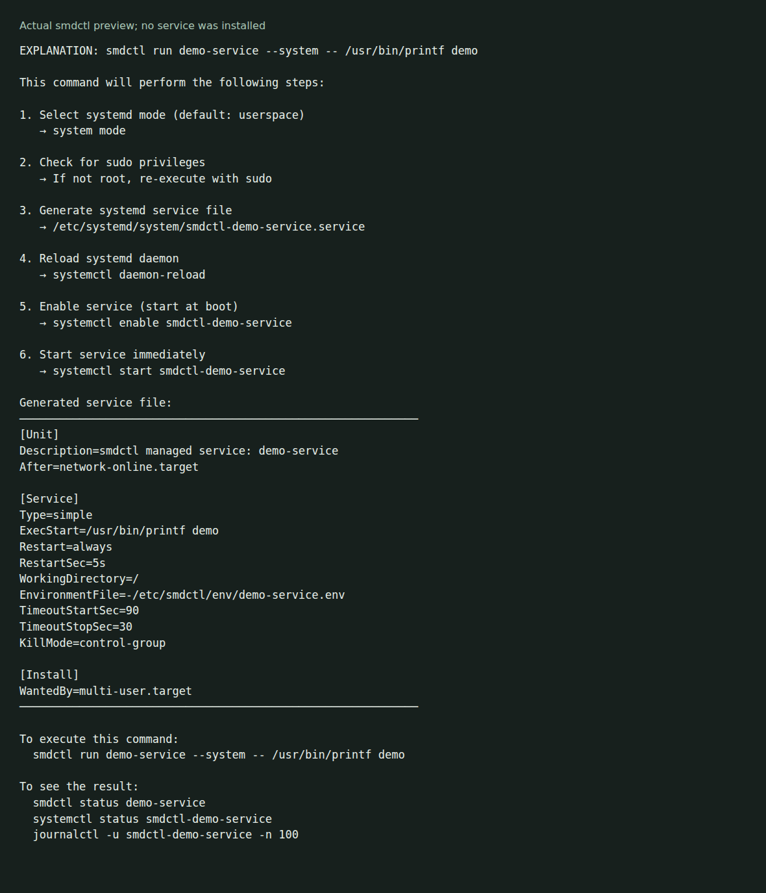

# smdctl

Manage Linux systemd services with command-line arguments or YAML configuration. smdctl writes unit files and calls systemctl for lifecycle operations.



The [local example](docs/demo/README.md) previews an inline service definition. It writes no unit files and starts no service.

## Build and preview

Use Go 1.23 or later:

```sh
git clone https://github.com/olegpustovit/smdctl.git
cd smdctl
make build
./target/release/smdctl explain run demo-service --system -- /usr/bin/printf demo
```

The `explain run` command prints the proposed operations and unit text. It is an explanation for inline arguments, not full validation of every YAML or run option.

[Release v0.1.1](https://github.com/olegpustovit/smdctl/releases/tag/v0.1.1) includes Linux amd64 and arm64 archives, checksums and an installer. The source build, rather than that installer, was used for the capture. `make install` uses sudo and installs to `/usr/local/bin`.

## Start a service

On a Linux host with a working systemd user manager:

```sh
smdctl run demo-web -- /usr/bin/python3 -m http.server 8000
smdctl status demo-web
smdctl logs demo-web
smdctl stop demo-web
smdctl rm demo-web
```

Use the actual path to Python on your host. Unlike `explain`, these commands change service state. The default mode uses your systemd user manager. Detected privileged ports or `--system` select system mode, which can require sudo.

See the [configuration and command reference](docs/reference.md) for YAML, timers, file locations and troubleshooting. Sample YAML files are in [examples](examples/).

## Verification

The Go test suite, go vet and source build passed on Linux ARM64. The captured explanation uses the real unit generator. It does not establish service startup, timers, privilege escalation or monitoring on this host.

[MIT license](LICENSE)
